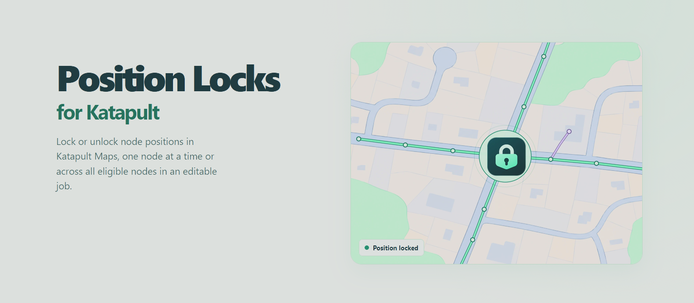

  

# Position Locks for Katapult

Public homepage for the independent Position Locks Chrome extension.

The homepage describes Position Locks **0.3.5**, including Single Node, All Job Nodes, and the new movable toolbar: unlock, drag, lock in place, and reset to the default dock.

[Home](https://azx-215.github.io/position-locks-offical/home) · [Support](https://azx-215.github.io/position-locks-support/support) · [Privacy policy](https://azx-215.github.io/position-locks-support/privacy)
